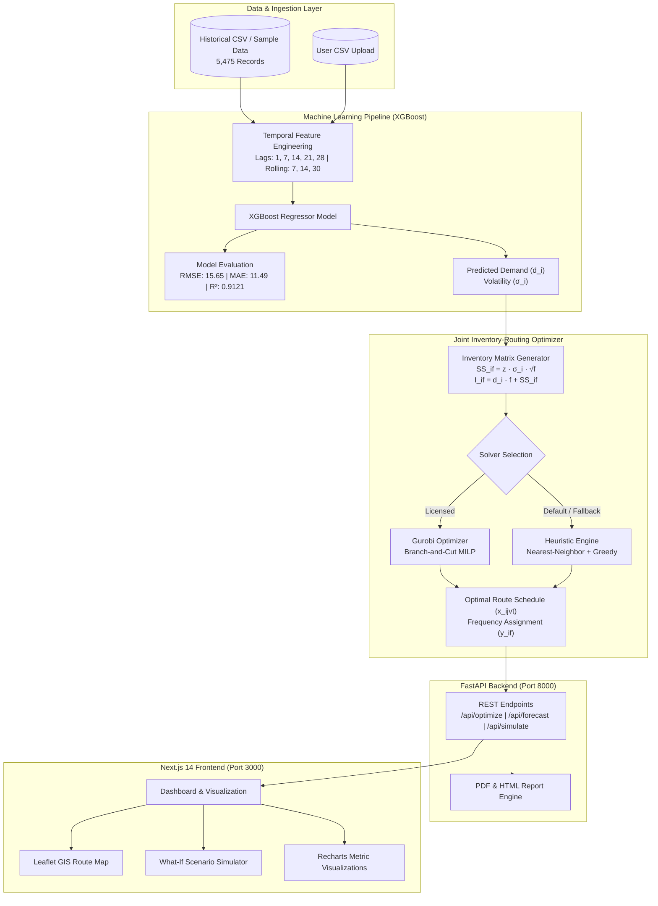

# 🚚 Vehicle Routing Problem & Inventory Optimizer (VRP-IO)

<div align="center">

[](https://github.com/vrp-inventory-optimizer/vrp-inventory-optimizer/actions/workflows/ci.yml)
[](https://fastapi.tiangolo.com)
[](https://nextjs.org)
[](https://www.python.org)
[](https://www.typescriptlang.org)
[](https://tailwindcss.com)
[](https://xgboost.readthedocs.io)
[](https://www.docker.com)
[](https://opensource.org/licenses/MIT)

**An End-to-End Decision Support System for Joint Vehicle Routing and Inventory Replenishment in Automotive Spare-Parts Distribution Networks**

[Key Features](#-key-features) • [Architecture](#-system-architecture) • [Mathematical Model](#-mathematical-formulation) • [Quick Start](#-quick-start-guide) • [Docker Compose](#-docker-quickstart) • [Deployment](#-cloud-deployment-guide) • [API Docs](#-api-endpoints-reference)

</div>

---

## 📌 Problem Overview & Motivation

In automotive supply chains, spare-parts distribution centers face a perpetual trade-off:
1. **Infrequent bulk shipments** reduce transportation mileage and fleet costs, but inflate warehouse cycle stock, increase carrying costs, and elevate capital lockup.
2. **Frequent lean replenishment** minimizes inventory carrying costs, but explodes vehicle kilometers traveled (VKT), fuel consumption, and fleet dispatch overhead.

The **VRP-IO** platform resolves this trade-off by solving the **Joint Inventory Routing Problem (IRP / VRPI)** over a multi-day planning horizon ($T = 7$ days). Using historical sales data, it trains an **XGBoost Machine Learning model** to forecast future dealer demand and demand volatility, dynamically sizes safety stock under non-linear replenishment frequencies, and computes the optimal route schedules and delivery frequencies via a **Mixed Integer Linear Programming (MILP)** solver (with automatic heuristic fallback).

The case study models an automotive distribution network based in **Chennai, India**, featuring a Central Warehouse Depot and **15 automotive dealership hubs**.

---

## ✨ Key Features

- 🧠 **Machine Learning Demand Forecasting (XGBoost)**:
  - Trained on 5,475 daily transaction records across 15 dealerships.
  - Multi-horizon temporal feature engineering: calendar cyclicality, weekly/bi-weekly/monthly lag features ($t-1, t-7, t-14, t-21, t-28$), and rolling window statistics (7, 14, 30 days).
  - Out-of-sample performance: **RMSE: 15.65**, **MAE: 11.49**, **$R^2$ Score: 0.9121**, **MAPE: 14.11%**.
  - One-click workflow to apply ML forecast outputs ($\hat{d}_i, \hat{\sigma}_i$) directly into the MILP optimization model.

- 📐 **Rigorous Mathematical Formulation**:
  - Multi-vehicle capacity-constrained routing with Miller-Tucker-Zemlin (MTZ) subtour elimination.
  - Discrete delivery frequency intervals: $F = \{1, 3, 5, 7\}$ days.
  - Non-linear safety stock sizing: $SS_{if} = z \cdot \sigma_i \cdot \sqrt{f}$ at 95% service level ($z = 1.65$).
  - Cycle stock and average inventory: $I_{if} = d_i \cdot f + SS_{if}$.
  - Objective minimizes combined **transportation expenditure** + **inventory holding costs**.

- ⚡ **Dual Solver Engine (Production-Grade)**:
  - **Gurobi MILP Engine**: High-performance branch-and-bound solver with MIP gap termination.
  - **Zero-Config Heuristic Fallback**: Built-in Nearest-Neighbor clustering and greedy frequency selector that executes seamlessly when Gurobi is unavailable.

- 🧪 **Interactive What-If Scenario Simulator**:
  - Live simulation of real-world disruptions and stress tests:
    - Demand surges (+10% to +50%)
    - Diesel fuel price volatility (₹80 to ₹140/liter)
    - Fleet availability constraints (vehicle breakdowns)
    - Inventory carrying cost fluctuations
    - Supply chain lead-time expansions
  - Visual delta comparisons (cost shift, mileage difference, service level impact).

- 🗺️ **Interactive GIS Geospatial Routing**:
  - Next.js Leaflet map displaying Central Depot and dealership coordinates.
  - Vehicle route visualization with custom color paths and sequential waypoint numbers.
  - Daily timeline and vehicle schedule breakdown.

- 📊 **Automated PDF & HTML Technical Reports**:
  - Generates comprehensive technical and executive reports with embedded charts, tables, and formulation summaries via `/api/report/pdf` and `/api/report/html`.

---

## 🏗️ System Architecture



---

## 📐 Mathematical Formulation

### 1. Sets and Indices
- $i, j \in N = \{0, 1, \dots, n\}$: Nodes where $0$ is the Central Depot and $1 \dots n$ are automotive dealerships.
- $v \in V$: Set of delivery fleet vehicles.
- $t \in T = \{1, 2, \dots, 7\}$: Discrete planning days in the horizon.
- $f \in F = \{1, 3, 5, 7\}$: Candidate replenishment intervals (days).

### 2. Decision Variables
- $x_{ijvt} \in \{0, 1\}$: 1 if vehicle $v$ traverses from node $i$ to node $j$ on day $t$; 0 otherwise.
- $y_{if} \in \{0, 1\}$: 1 if dealership $i$ is assigned delivery frequency $f$; 0 otherwise.
- $z_{it} \in \{0, 1\}$: 1 if dealership $i$ is visited on day $t$; 0 otherwise.
- $q_{ivt} \ge 0$: Quantity delivered to dealership $i$ by vehicle $v$ on day $t$.
- $u_{it} \ge 0$: Auxiliary variable for MTZ subtour elimination.

### 3. Inventory Relationships
$$\text{Safety Stock: } SS_{if} = z \cdot \sigma_i \cdot \sqrt{f}$$
$$\text{Average Inventory: } I_{if} = d_i \cdot f + SS_{if} = d_i \cdot f + z \cdot \sigma_i \cdot \sqrt{f}$$

### 4. Objective Function
$$\min Z = \underbrace{\sum_{t \in T}\sum_{v \in V}\sum_{i \in N}\sum_{j \in N} c_{ij} \cdot x_{ijvt}}_{\text{Transportation Routing Cost}} + \underbrace{\sum_{i=1}^n \sum_{f \in F} h_i \cdot I_{if} \cdot y_{if}}_{\text{Inventory Holding Cost}}$$

### 5. Constraints
1. **Single Frequency Selection**: $\sum_{f \in F} y_{if} = 1 \quad \forall i \in \{1 \dots n\}$
2. **Frequency-Visit Harmonization**: $\sum_{t \in T} z_{it} = \sum_{f \in F} \left(\frac{|T|}{f}\right) y_{if} \quad \forall i$
3. **Vehicle Fleet Capacity**: $\sum_{i=1}^n q_{ivt} \le Q_v \quad \forall v \in V, t \in T$
4. **Flow Conservation & Depot Return**: $\sum_{j \in N} x_{ijvt} = \sum_{j \in N} x_{jivt} \quad \forall i \in N, v \in V, t \in T$
5. **Subtour Elimination (MTZ)**: $u_{it} - u_{jt} + n \sum_{v \in V} x_{ijvt} \le n - 1 \quad \forall i, j \ge 1, i \ne j, t \in T$

---

## 📁 Repository Structure

```
vrp-inventory-optimizer/
├── .github/
│   ├── workflows/
│   │   └── ci.yml                     # GitHub Actions CI (lint, build & pytest)
│   ├── ISSUE_TEMPLATE/
│   │   ├── bug_report.md              # Standard bug report template
│   │   └── feature_request.md         # Feature request template
│   └── pull_request_template.md       # PR checklist & template
├── backend/
│   ├── app/
│   │   ├── models/                    # Pydantic data schemas
│   │   │   └── schemas.py
│   │   ├── routers/                   # FastAPI route controllers
│   │   │   ├── data.py                # Sample & CSV data endpoints
│   │   │   ├── forecast.py            # XGBoost training & forecast
│   │   │   ├── optimize.py            # MILP / Heuristic optimization
│   │   │   └── simulate.py            # What-If simulator engine
│   │   ├── services/                  # Business logic & algorithms
│   │   │   ├── forecasting.py         # XGBoost model & feature engineering
│   │   │   ├── preprocessing.py       # Distance matrix & inventory tables
│   │   │   ├── solver.py              # Gurobi & Heuristic solvers
│   │   │   ├── result_parser.py       # Route & inventory formatters
│   │   │   └── simulation.py          # Sensitivity & scenario models
│   │   ├── config.py                  # App configuration & parameters
│   │   └── main.py                    # FastAPI application entrypoint
│   ├── data/                          # Datasets
│   │   ├── historical_demand.csv      # 5,475 daily transaction records
│   │   ├── sample_dealers.csv         # 15 Chennai dealership hubs
│   │   ├── sample_demand.csv          # Demand baselines
│   │   └── sample_vehicles.csv        # Fleet specs & capacities
│   ├── tests/                         # Pytest test suite
│   │   ├── test_health.py             # Health & root checks
│   │   ├── test_schemas.py            # Schema validation tests
│   │   ├── test_forecast.py           # ML forecast endpoint tests
│   │   └── test_solver.py             # Heuristic solver tests
│   ├── Dockerfile                     # Containerization for backend
│   ├── requirements.txt               # Python package dependencies
│   └── .env.example                   # Backend environment template
├── frontend/
│   ├── src/
│   │   ├── app/                       # Next.js App Router
│   │   │   ├── layout.tsx
│   │   │   └── page.tsx
│   │   ├── components/                # React components
│   │   │   ├── CostSummary.tsx        # Executive financial summary
│   │   │   ├── Dashboard.tsx          # Main tabbed workspace
│   │   │   ├── DemandForecast.tsx     # XGBoost charts & metrics
│   │   │   ├── FileUpload.tsx         # CSV upload & sample loader
│   │   │   ├── FrequencyResults.tsx   # Optimal delivery frequency table
│   │   │   ├── InventoryResults.tsx   # Safety stock & inventory matrix
│   │   │   ├── ModelFormulation.tsx   # Mathematical model presentation
│   │   │   ├── RouteMap.tsx           # Interactive Leaflet GIS map
│   │   │   ├── RouteResults.tsx       # Daily route sequences & mileage
│   │   │   └── WhatIfSimulator.tsx    # Live disruption simulator
│   ├── Dockerfile                     # Multi-stage production container
│   ├── package.json                   # Dependencies & scripts
│   ├── tsconfig.json                  # TypeScript configuration
│   ├── tailwind.config.ts             # Tailwind CSS tokens
│   └── .env.example                   # Frontend environment template
├── docker-compose.yml                 # One-click multi-container stack
├── DEPLOYMENT_GUIDE.md                # Cloud deployment instructions (Vercel/Render)
├── CONTRIBUTING.md                    # Guidelines for contributing
├── CODE_OF_CONDUCT.md                 # Contributor Covenant standard
├── SECURITY.md                        # Security & vulnerability reporting
├── LICENSE                            # MIT License
└── render.yaml                        # Blueprint for Render.com deployment
```

---

## 🚀 Quick Start Guide

### Prerequisites
- **Python**: 3.11 or higher
- **Node.js**: 18.x or 20.x
- **npm** or **yarn**

---

### Option A: Standard Local Development

#### 1. Clone the Repository
```bash
git clone https://github.com/<your-username>/vrp-inventory-optimizer.git
cd vrp-inventory-optimizer
```

#### 2. Setup & Launch Backend
```bash
cd backend

# Create and activate Python virtual environment
python -m venv venv
# On Windows:
.\venv\Scripts\activate
# On macOS / Linux:
source venv/bin/activate

# Install dependencies
pip install --upgrade pip
pip install -r requirements.txt

# Start FastAPI development server (runs on port 8000)
uvicorn app.main:app --reload --port 8000
```
Verify the API: [http://localhost:8000/api/health](http://localhost:8000/api/health) → `{"status": "healthy"}`

#### 3. Setup & Launch Frontend
In a new terminal window:
```bash
cd frontend

# Install Node modules
npm install

# (Optional) configure environment
cp .env.example .env.local

# Launch Next.js dev server
npm run dev
```
Open **[http://localhost:3000](http://localhost:3000)** in your browser!

---

### Option B: Docker Quickstart (One Command)

Run both the FastAPI backend and Next.js frontend together in isolated containers:

```bash
docker compose up --build
```

- **Frontend Application**: [http://localhost:3000](http://localhost:3000)
- **Backend API Docs**: [http://localhost:8000/docs](http://localhost:8000/docs)
- **Health Check**: [http://localhost:8000/api/health](http://localhost:8000/api/health)

---

## ⚙️ Environment Variables

### Frontend (`frontend/.env.local`)
| Variable | Default Value | Description |
| :--- | :--- | :--- |
| `NEXT_PUBLIC_API_URL` | `http://localhost:8000` | Address of the FastAPI backend service |

### Backend (`backend/.env`)
| Variable | Default Value | Description |
| :--- | :--- | :--- |
| `PORT` | `8000` | Port for the Uvicorn web server |
| `PLANNING_HORIZON` | `7` | Days in the planning schedule horizon |
| `SERVICE_LEVEL_Z` | `1.65` | Z-score for safety stock sizing (1.65 = 95%) |
| `SOLVER_TIME_LIMIT` | `300` | Maximum solver execution cutoff (seconds) |
| `GUROBI_LICENSE_FILE` | *(Optional)* | Absolute path to Gurobi license file |

---

## 📡 API Endpoints Reference

| Method | Endpoint | Description |
| :--- | :--- | :--- |
| `GET` | `/api/health` | Health check endpoint returning service status |
| `GET` | `/` | API welcome metadata & report links |
| `POST` | `/api/optimize` | Runs joint VRP and inventory optimization |
| `POST` | `/api/forecast` | Trains XGBoost model and forecasts dealer demands |
| `GET` | `/api/forecast/sample` | Instant retrieval of cached ML metrics & predictions |
| `POST` | `/api/forecast/upload` | Upload custom sales history CSV and run ML pipeline |
| `POST` | `/api/simulate` | Executes sensitivity analysis & What-If stress test |
| `GET` | `/api/report/pdf` | Downloads comprehensive technical PDF report |
| `GET` | `/api/report/html` | Streams interactive technical HTML report |
| `GET` | `/docs` | Interactive Swagger UI API documentation |

---

## 🧪 Testing & Validation

### Backend Pytest Suite
```bash
cd backend
python -m pytest tests/ -v
```
Checks schema validation, heuristic solver reliability, ML sample forecast endpoints, and API health checks.

### Frontend Production Build
```bash
cd frontend
npm run build
npm run lint
```
Validates Next.js compilation, TypeScript types, and Tailwind styles.

---

## ☁️ Cloud Deployment Guide

This project is architected for **zero-cost** cloud hosting:

1. **Frontend on Vercel**:
   - Connect your GitHub repository.
   - Set **Root Directory** to `frontend`.
   - Set environment variable: `NEXT_PUBLIC_API_URL=https://your-backend-app.onrender.com`.
   - Automatic SSL, Edge CDN, and zero configuration.

2. **Backend on Render.com or Hugging Face Spaces**:
   - **Render**: Connect repository, set Root Directory to `backend`, runtime Python 3, build `pip install -r requirements.txt`, start `uvicorn app.main:app --host 0.0.0.0 --port $PORT`. (Included in [`render.yaml`](render.yaml)).
   - **Hugging Face Spaces**: Docker Space utilizing [`backend/Dockerfile`](backend/Dockerfile) with **16GB RAM free**.

For detailed step-by-step instructions, see [DEPLOYMENT_GUIDE.md](DEPLOYMENT_GUIDE.md).

---

## 🤝 Contributing

Contributions are welcome! Please review [CONTRIBUTING.md](CONTRIBUTING.md) for details on code standards, branch naming conventions, and the pull request process.

---

## 📜 License

This project is licensed under the **MIT License** — see the [LICENSE](LICENSE) file for details.
